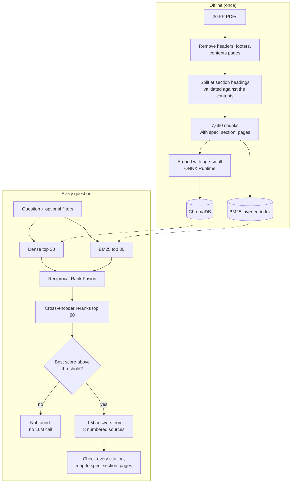

# TelecomDocQA

**Cited answers to 5G questions, drawn only from 3GPP specifications.**

&nbsp;**[Live demo](https://telecomdocapp-xlmnq8s6kdkrfm9a4p4w7x.streamlit.app/)**

Ask a question about 5G and TelecomDocQA searches 2,264 pages of 3GPP Release 18
specifications, writes a short answer, and cites the spec, section and pages behind
every claim. Questions the specifications don't cover are refused instead of guessed.

## How it works

- **Hybrid retrieval:** dense embeddings (`bge-small-en-v1.5`, ChromaDB) understand meaning, BM25 catches exact terms like `N2` or `S-NSSAI`; Reciprocal Rank Fusion merges them, and a cross-encoder reranks the top 20.
- **Grounded answers:** the LLM (`gpt-oss-120b`) may only use 8 numbered sources and must cite one after every claim; each citation is checked against the sources.
- **Refuses instead of guessing:** if no chunk is relevant enough, it answers "not found" without calling the LLM.

## Results

Measured on 68 test questions (58 answerable, 10 unanswerable), with answers graded
by an LLM judge from a different model family.

| Metric | Result |
|---|---|
| Recall@5 (right section in the top 5) | **0.91** (hybrid alone: 0.83) |
| MRR@10 | **0.80** |
| Answer correctness | **0.85** (0.78 with 5 sources instead of 8) |
| Faithfulness (claims supported by sources) | **0.94** |
| Out-of-scope questions refused | **10 / 10** |
| End-to-end latency, p50 / p95 | 2.1 s / 2.9 s |

Full reports, including the BM25 / dense / hybrid comparison: [`data/eval/results/`](data/eval/results/).

## Engineering

- **FastAPI service** with request validation, streaming answers, an answer cache and rate limits.
- **147 tests** and GitHub Actions CI that also builds and smoke-tests the Docker image.
- **Runs on a free server:** models moved from PyTorch to ONNX Runtime and BM25 rewritten as a compact index (76 MB → 23 MB), with retrieval quality measured as unchanged.

## Known limitations

- Three questions (e.g. "Which function allocates IP addresses?") miss the right section in the top 10.
- PDF tables are flattened into plain text, so table-based questions are answered poorly.
- The test questions were drafted with AI assistance; every reference answer was then checked against the spec text.

## Tech stack

Python · ChromaDB · BM25 · fastembed / ONNX Runtime · Groq (gpt-oss-120b) · FastAPI · Streamlit · Docker · pytest · GitHub Actions

Setup, commands and how to reproduce every number: **[SETUP.md](SETUP.md)**.

---
Specifications © ETSI and the 3GPP Organizational Partners, free at [etsi.org](https://www.etsi.org/deliver/). Non-commercial, educational project.
