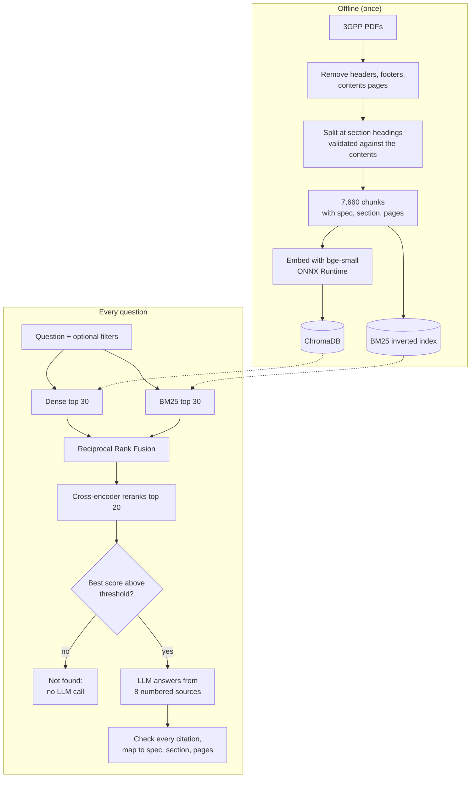

# TelecomDocQA

**Cited answers to 5G questions, drawn only from 3GPP specifications.**

[](https://github.com/Niyatiiii06/TelecomDocQA/actions/workflows/ci.yml)
&nbsp;**[Live demo](https://telecomdocapp-xlmnq8s6kdkrfm9a4p4w7x.streamlit.app/)**

Ask *"How is the SUPI protected over the air?"* and TelecomDocQA searches 2,264 pages
of 3GPP Release 18 specifications, writes a short answer, and cites the spec, section
and pages behind every claim. Questions the specifications don't cover are refused
instead of guessed.

| | |
|---|---|
| **Corpus** | 4 specifications (TS 38.300, 23.501, 23.502, 33.501), 2,264 pages, 7,660 section-aware chunks |
| **Retrieval** | Dense (`bge-small-en-v1.5`, ChromaDB) + BM25, fused with Reciprocal Rank Fusion, then cross-encoder reranking |
| **Answers** | `gpt-oss-120b` (Groq), allowed to use only the 8 retrieved sources, with every citation checked |
| **Quality** | Recall@5 **0.93**, MRR **0.81**, answer correctness **0.85**, faithfulness **0.94**, out-of-scope refusals **10/10** |
| **Engineering** | FastAPI with streaming, 147 tests, GitHub Actions CI with a Docker smoke test, free CPU deployment |

## How it works



1. **Ingestion** (`ingest.py`, `chunking.py`). Repeated headers and footers are removed by comparing lines with numbers masked, so `...V18.6.0 (2025-07)63GPP` and `...64` match. Headings are accepted only if the spec's own table of contents lists them, which filters out numbered table rows and procedure steps that look like headings. Sections are split into ~200-word chunks with 40 words of overlap.
2. **Hybrid retrieval** (`retrievers.py`). Embeddings capture meaning ("move between cells" finds "handover"); BM25 catches exact identifiers like `N2`, `S-NSSAI` and `TS 23.501`, with a tokenizer that keeps them intact. RRF merges the two lists by rank, because their raw scores aren't comparable. Results can be filtered by spec, topic or section prefix.
3. **Reranking** (`reranker.py`). A cross-encoder reads the question and each candidate together. It's too slow to score all 7,660 chunks, so it reorders the top 20.
4. **Grounded answers** (`answer.py`). The LLM sees 8 numbered sources and must cite one after every claim. Citations are parsed, mapped back to their chunk, and made-up numbers are flagged. If even the best chunk scores below a threshold tuned on the evaluation set, the system answers "not found" without calling the LLM.

## Results

All numbers come from `data/eval/questions.jsonl`: 68 questions written from the
specification text, 58 answerable (each labelled with its gold section and a reference
answer) and 10 unanswerable (off-topic, or about 5G but not covered by these specs).
Gold labels are sections, not chunk IDs, so the set stays valid if the chunking changes.

### Retrieval ablation (58 answerable questions)

| Setup | Recall@1 | Recall@5 | Recall@10 | MRR@10 | p50 latency |
|---|---|---|---|---|---|
| BM25 only | 0.47 | 0.69 | 0.76 | 0.57 | 2 ms |
| Dense only | 0.66 | 0.90 | 0.91 | 0.75 | 11 ms |
| Hybrid (RRF) | 0.57 | 0.81 | 0.88 | 0.66 | 14 ms |
| **Hybrid + rerank** | **0.72** | **0.93** | **0.97** | **0.81** | 1.4 s |

- Reranking adds +0.12 Recall@5 and +0.15 MRR over plain hybrid retrieval.
- Plain RRF scores *below* dense alone: BM25's weaker list pulls good dense results down. The reranker recovers them, because it rescores every candidate on its own merits.
- Reranking more candidates didn't help: 20, 30 and 40 candidates all gave Recall@5 0.93, while p50 search latency rose from 1.0 s to 2.0 s (measured with the earlier PyTorch build). The system keeps 20.

### Answer quality (LLM-as-judge)

Correctness (against the reference answer) and faithfulness (claims supported by the
cited sources) are graded by `qwen3.8-27b`, a different model family from the answer
model, to avoid a model grading its own answers.

| Metric | 5 sources | **8 sources** |
|---|---|---|
| Answer correctness (correct = 1, partial = 0.5) | 0.78 | **0.85** |
| Correct / partial / incorrect / wrongly refused | 39 / 13 / 5 / 1 | **45 / 9 / 4 / 0** |
| Faithfulness | 0.90 | **0.94** |
| Citation precision (strict: gold sections only) | 0.67 | 0.61 |
| Refusals on unanswerable questions | 10/10 | **10/10** |
| End-to-end latency p50 / p95 | 2.1 s / 2.6 s | 2.1 s / 2.9 s |

Recall@8 (0.97) was higher than Recall@5 (0.93), so the LLM gets 8 sources: questions
whose gold section ranked 6th to 8th now reach the LLM (q01 went from refused to correct). Citation precision
fell because answers also cite related sections that aren't labelled gold, so it is a
lower bound. Full reports: [`data/eval/results/`](data/eval/results/).

### Running on a small free server

Free hosting offers roughly 0.5 to 1 GB of memory. Two changes made the app fit without
changing what it retrieves (re-measured: Recall@5 and MRR identical to the table above):

| Change | Effect |
|---|---|
| Both models run on **ONNX Runtime** (fastembed) instead of PyTorch | No 800 MB PyTorch install; same two models |
| **BM25 rewritten as a compact inverted index** (numpy arrays) instead of `rank_bm25` | Identical rankings on all 68 questions; index memory 76 MB → 23 MB; ~40x faster per query (8.1 → 0.2 ms) |

The app without the two models peaks at about 230 MB.

## Known limitations

- **Retrieval misses (2 of 58).** For broad questions such as "Which network function allocates IP addresses?" (q22) and "Which function generates authentication credentials?" (q25), the gold section isn't in the top 10 even when 40 candidates are reranked: the answer is one bullet inside a long section about something else. A query-rewriting (agentic) retrieval step is the planned fix.
- **Reasoning errors.** In q15 and q18 the right sources were retrieved but the model drew the wrong conclusion. A self-check pass that verifies the answer against its sources is planned.
- **Tables.** PDF tables are flattened into text by `pypdf`, so questions about table contents (e.g. 5QI values) are answered poorly.
- **Evaluation caveats.** The questions were drafted with AI assistance from the specification text and are being reviewed by hand (each has a `verified` flag; label changes are logged in [`data/eval/README.md`](data/eval/README.md)). An LLM judge is not a human grader. Answer metrics were measured before the ONNX switch; retrieval was re-measured after it and is unchanged.
- **Demo limits.** The cache and rate limits live in memory, so they reset on restart and wouldn't be shared across several servers (a production system would use e.g. Redis).

## Reproduce the results

Specs (Release 18, free PDFs from ETSI; links in [`data/raw/README.md`](data/raw/README.md)):
TS 38.300 V18.6.0, TS 23.501 V18.12.0, TS 23.502 V18.7.0, TS 33.501 V18.7.0.
All library versions are pinned in `requirements.txt`; the LLM runs at temperature 0.

```bash
python -m venv .venv && source .venv/bin/activate        # Windows: .venv\Scripts\activate
pip install -r requirements-dev.txt
cp .env.example .env                                     # add a free Groq key: console.groq.com/keys

python -m telecomdocqa.chunking                          # -> 7,660 chunks
python -m telecomdocqa.index_builder                     # embeds them into ChromaDB (~5-10 min on CPU)

python -m telecomdocqa.eval_retrieval                    # retrieval ablation (no LLM, ~5 min)
python -m telecomdocqa.eval_retrieval --candidates 20 30 40
python -m telecomdocqa.eval_answers                      # answers + judge (uses LLM quota; --resume if it stops)
```

The free Groq tier allows ~200,000 tokens per model per day, about one full answer
evaluation; `--resume` continues a run that hit the limit.

## Run it

```bash
python -m telecomdocqa.answer "What is the role of the AMF?"           # command line
python -m telecomdocqa.search "registration procedure" --doc ts_23502 --section 4.2
uvicorn telecomdocqa.api:app --reload                                  # API + demo page at :8000, docs at /docs
streamlit run streamlit_app.py                                         # the live demo's interface
docker build -t telecomdocqa . && docker run -p 7860:7860 --env-file .env telecomdocqa
```

| Endpoint | |
|---|---|
| `GET /health` | Status and models in use |
| `POST /search` | Retrieval only, no LLM |
| `POST /ask` | Full answer with checked citations |
| `GET /ask/stream` | The same, streamed as Server-Sent Events: sources, then answer tokens, then checked citations |

Requests are validated with Pydantic (question length, known spec and topic, section
format). Repeated questions are served from an LRU cache, and new ones are limited to
10 per visitor per hour and 50 per day, to stay within the free LLM quota.

## Testing and CI

`pytest` runs 147 tests in about 5 seconds: PDF cleaning and heading detection,
chunking, every retriever and filter (on a real ChromaDB index in a temporary folder),
RRF, BM25 equivalence with `rank_bm25`, reranking, citation parsing, the metrics, the
API (validation, streaming, errors, cache, rate limits), the Streamlit page, and the
evaluation set itself (valid gold labels, unique IDs). Tests use small fake models with
the real interfaces, so they need no API key, downloads or PDFs.

GitHub Actions lints with `ruff`, runs the tests, then builds the Docker image and
smoke-tests the running container with the real models and index.

## Deployment

The live demo runs on Streamlit Community Cloud (free, ~1 GB memory). The prebuilt
index is published to a Hugging Face dataset (`deploy/publish_index.py`) and downloaded
at startup (`telecomdocqa/remote_index.py`), so the server needs neither the PDFs nor
the 10-minute indexing step. The LLM key is a Streamlit secret.

## Project structure

```
telecomdocqa/
  ingest.py, chunking.py        PDF cleaning, section detection, chunking
  embeddings.py, index_builder.py   ONNX embeddings into ChromaDB
  retrievers.py                 BM25, dense, RRF hybrid, metadata filters
  reranker.py, pipeline.py      cross-encoder reranking; retrieve-then-rerank
  answer.py, llm.py             grounded prompt, citation checking, streaming
  metrics.py, judge.py          Recall@k, MRR, citation precision; LLM judge
  eval_retrieval.py, eval_answers.py   evaluation scripts
  api.py, limits.py, static/    FastAPI service, cache and rate limits, demo page
  remote_index.py, config.py    index download; all settings in one place
streamlit_app.py                live demo
data/eval/                      test set, label-change log, results
tests/                          147 tests
deploy/publish_index.py         publishes the index to Hugging Face
```

## Acknowledgements

The specifications are © ETSI and the 3GPP Organizational Partners, published free of
charge at [etsi.org](https://www.etsi.org/deliver/). This is a non-commercial,
educational project.
